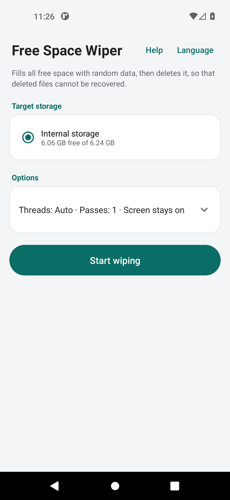
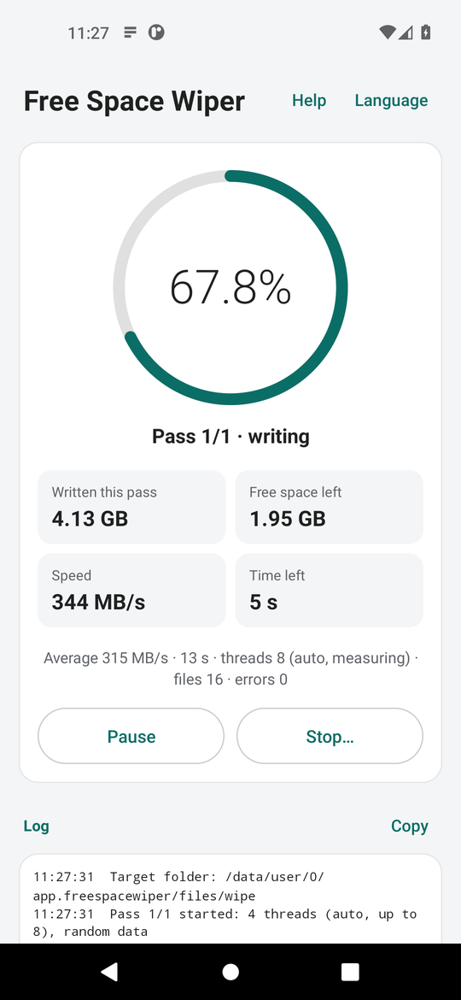
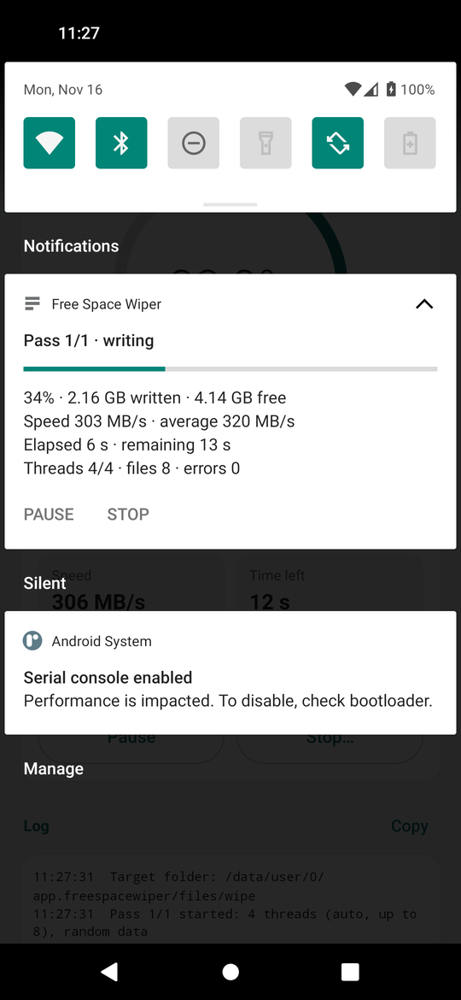
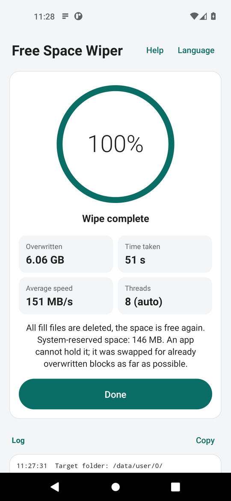
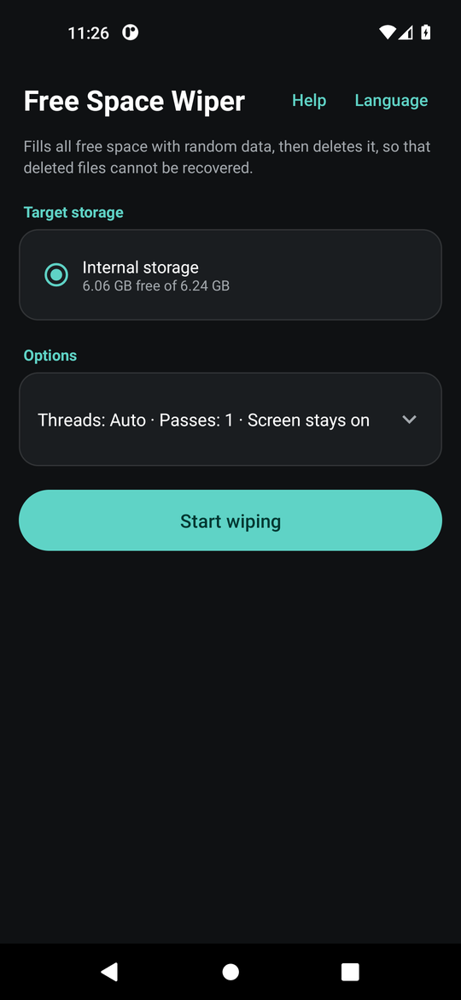

# Free Space Wiper

English | [简体中文](README.zh-CN.md)

[](https://github.com/Tianket/FreeSpaceWiper/actions/workflows/build.yml)
[](https://github.com/Tianket/FreeSpaceWiper/actions/workflows/device-test.yml)
[](https://github.com/Tianket/FreeSpaceWiper/releases/latest)

An Android app that fills all free space of a storage with random data, makes sure the data reaches the flash, and deletes it again. The space that deleted files used to occupy is overwritten, so recovery tools have nothing left to find. Existing files are not touched.

The app is available in English and Simplified Chinese. It has no internet permission and no third-party libraries.

<p>
  
  
  
  
  
</p>

## Features

- **Fills every free byte**: writes until the system reports the storage is full, then squeezes the last gaps with small writes. The data comes from AES-256-CTR and cannot be compressed.
- **Clears the system-reserved space**: a "full" storage still keeps some space for the system that an app cannot occupy, and old data can sit there. An extra step makes the file system hand those blocks out too (see below).
- **Picks the thread count by itself**: CPU cores and memory set the starting point and the upper limit. While writing, the app measures the speed and doubles the threads for as long as that makes it faster, up to 32.
- **Survives interruptions**:
  - Foreground service with a wake lock, so it keeps writing with the screen off. At the first launch the app asks the system to let it run in the background.
  - If the system ends the process, it restarts and continues; after a phone restart it continues on its own. Data already written is kept.
  - Pause and continue at any time. At 5% battery without a charger it pauses, and continues by itself when the charger is connected.
  - On Android 11 and later it shows why the system ended the process last time.
- **Clear progress**: a progress ring, data written, free space left, current speed and time left in the app; the same progress in the notification, with Pause and Stop buttons.
- **SD cards**: removable storage appears in the target list.
- Light and dark theme; dynamic colors on Android 12 and later.

## Download

Android 6.0 or later.

Download `FreeSpaceWiper-<version>.apk` from the [latest release](https://github.com/Tianket/FreeSpaceWiper/releases/latest). The `.sha256` file next to it holds the checksum, which is also printed in the release notes.

Every build is signed with a key generated for that build. Uninstall the app before installing an APK from a different release.

The newest build of `main` is also on the [Actions](https://github.com/Tianket/FreeSpaceWiper/actions/workflows/build.yml) page as `FreeSpaceWiper-apk` (needs a GitHub login). The "APK checksum and contents" step of that run lists its SHA-256, permissions, signature check and the classes inside.

## Usage

1. Open the app. At the first launch the system asks whether the app may run in the background: allow it.
2. Pick the target storage and tap **Start wiping**. Keep the phone on the charger.
3. Wait until it finishes. The storage is full for a while and other apps may complain about low space; the fill files are deleted automatically at the end.

The defaults suit almost every phone. **Options** is folded into one line; tap it to change them:

| Option | What it does |
|---|---|
| Parallel threads | **Auto** by default: starts with one thread per CPU core (at most 8) and doubles while the measured speed keeps rising. Can also be fixed at 2, 4, 8, 16 or 32. The flash sets the real limit: beyond what it can take, more threads are not faster. |
| Passes | 1 to 3, default 1. One pass is enough on flash storage. |
| Keep the screen on | On by default. A lit screen with the app open is the most reliable way to keep vendor power managers from interfering. |

Some vendors add their own background limits that have to be lifted once by hand:

| Brand | Where |
|---|---|
| Xiaomi / HyperOS | App info → Battery saver → No restrictions |
| Huawei / Honor | App launch → Manage manually, allow background activity |
| OPPO / OnePlus / realme | Battery → Allow background activity |
| vivo / iQOO | Battery → Allow high background power consumption |
| Samsung | Battery → Unrestricted |

## How it works

Each pass goes through these phases:

| Phase | What happens |
|---|---|
| Writing | Several threads each write files (up to 1 GiB each) in 1 MiB writes, until the system reports the storage is full. |
| Filling the last bytes | One thread fills what is left with 64 KiB, then 4 KiB writes. |
| Clearing reserved space | See below. |
| Deleting | All fill files are deleted and the space is free again. |

Key points:

- **On the flash before it is deleted.** Every file is fsync'ed before it is closed, and periodically while it is written. Without that, data still in the page cache would simply be dropped when the file is deleted and never reach the flash.
- **Every byte is really written.** No `fallocate`, no sparse files: the file system has to hand out every block it can.
- **Bounded memory.** All threads share one budget for data that is written but not yet synced (128 MiB to 1 GiB, depending on RAM). With more threads, each one syncs more often, so more threads do not mean more memory.
- **The thread count is measured.** The upper limit is the smallest of: 4 × CPU cores, a RAM tier (8 below 3 GB, 16 below 6 GB, 32 otherwise), and what the app's heap allows. In auto mode the speed is compared every few seconds: more than 8% faster than with the previous count means double again; otherwise go back to the previous count and keep it.

### Clearing the system-reserved space

File systems usually keep some space for system processes. When the app reaches "storage full", those blocks are still free and may still hold old data. The app cannot occupy them, but it can influence which blocks the file system leaves free:

1. With the storage full, delete the oldest fill files to free about twice the reserved space.
2. Fill that space again with 64 KiB files, then delete every second one. The freed space is now made of isolated small holes.
3. Fill up again with large files. The allocator prefers contiguous free space, so it uses up what is left of the reserved area first, and what stays free at the end are the small holes that already hold random data.

This is repeated three times. The test results below show the effect.

## Testing

All three kinds of tests run on GitHub Actions; the log of each run shows its results.

**Unit tests** (18, `app/src/test`): the real engine on a small simulated volume, covering filling, several passes, cancelling, pausing, resuming, the per-file size limit, write errors, the automatic thread count, clearing reserved space, and the progress display.

**Raw disk scan** (`verify/run.sh`): on disk images with real file systems, write files full of marker blocks and delete them, run the engine as an unprivileged user, then scan the raw image for marker blocks (4 KiB each) that can still be read. The images are mounted without discard, so whatever is found are blocks the file system did not write again. "Aged" means the volume is 85% full, with the marked files interleaved with files that stay, and only the marked ones deleted. The table shows the range over 7 runs during development:

| File system and case | Marker blocks before the wipe | After |
|---|---|---|
| F2FS, fresh volume | 550400 | 0 |
| F2FS, aged volume | 314880 | 0 |
| F2FS, aged, with space reserved for the system (`reserve_root`, as on Android) | 314880 | 0 |
| F2FS, killed with `kill -9` half way and resumed | 550400 | 0 to 129 |
| ext4, fresh volume (5% reserved) | 550400 | 0 to 19 |
| ext4, aged volume (5% reserved) | 317440 | 0 to 27 |
| ext4, killed with `kill -9` half way and resumed | 550400 | 0 to 3 |
| ext4, aged, with the reserved-space step turned off (for comparison) | 317440 | 29842 to 32153 |

The largest leftover was 129 blocks, 0.02%. A run passes when at most 0.1% is left.

To run it locally: `verify/run.sh ext4` or `LAYOUT=aged verify/run.sh f2fs`. It needs sudo, a JDK and python3; the options are described at the top of the script.

**Emulator test** (`ci/device_test.py`): installs the built APK on Android 6, 11 and 14 emulators, operates it through adb the way a person would, and judges each result by reading the real state of the device as root (size of the fill files, foreground service, wake lock, notification, battery optimization allowlist). Covered:

- The first launch shows the system's background permission dialog; after Allow the app is on the battery allowlist.
- Switching between English and Chinese, dark theme.
- A complete wipe: the notification shows progress, the service runs in the foreground with a wake lock; afterwards no fill files are left and the free space is back.
- Pause, continue and stop.
- The process is killed with `kill -9`: the system restarts the service, the wipe continues, and what was written before is kept.
- At 3% battery without a charger it pauses; connecting the charger continues it.
- The device restarts: after boot the wipe continues by itself and finishes.

Screenshots and logs of each run are attached to it as `device-test-apiNN`.

## Permissions

| Permission | Used for |
|---|---|
| `FOREGROUND_SERVICE`, `FOREGROUND_SERVICE_SPECIAL_USE` | Running the wipe as a foreground service |
| `WAKE_LOCK` | Keeping the CPU running with the screen off |
| `POST_NOTIFICATIONS` | Progress and result in the notification shade |
| `REQUEST_IGNORE_BATTERY_OPTIMIZATIONS` | Asking the system to let the app run in the background |
| `RECEIVE_BOOT_COMPLETED` | Continuing an interrupted wipe after a restart |

No internet permission and no storage permission: the app only writes into its own folder. That folder is on the same partition as the internal storage, so filling it fills the whole internal storage. On SD cards the app's own folder on the card is used.

## Limits

- File names, timestamps and the contents of very small files can sit in file-system metadata that filling free space does not reach.
- The small amount of space a file system keeps for itself cannot always be swapped out completely; the test results above are measurements of that.
- Spare blocks inside the flash controller (wear levelling, over-provisioning) are out of reach of every app.
- Storage encryption plus a factory reset covers all of these: the reset destroys the encryption key. To clear a whole device, reset it first and run this app afterwards.
- The app only overwrites free space and has no "shred one file": on flash and F2FS, overwriting a file writes the new data elsewhere and leaves the old blocks alone.
- The emulator test covers stock Android. The background management of individual vendors differs and was not tested one by one.

## Building

Needs JDK 17 and the Android SDK (API 34).

```
./gradlew assembleRelease
```

The APK ends up in `app/build/outputs/apk/release/app-release.apk`. The folder can also be opened in Android Studio.

```
./gradlew test          # unit tests
./gradlew lintRelease   # lint
```

To publish a release, raise `versionCode` and `versionName` in `app/build.gradle`, then run **Actions → Release → Run workflow**. It builds the APK and publishes it with its checksum as release `v<versionName>`. Pushing a tag `v<versionName>` does the same.

## Project layout

```
app/src/main/java/app/freespacewiper/
  engine/                 plain Java core without Android dependencies; runs and is tested on a desktop JVM
    WipeEngine.java         writing, filling, clearing reserved space, deleting; pause, cancel, resume, thread tuning
    WipeConfig.java         job parameters
    Snapshot.java           progress snapshot
    DataSource.java         AES-256-CTR random data stream
    Platform.java           file system abstraction (open / write / fsync / statvfs)
  AndroidPlatform.java    direct system calls through android.system.Os
  WipeService.java        foreground service: wake lock, notification, pause and continue, low battery, recovery
  MainActivity.java       the screen, in three states: before starting, running, result
  RingProgressView.java   progress ring
  DeviceInfo.java         thread start, thread limit and memory budget, from CPU and RAM
  JobStore.java           job state that stays reliable while the storage is full
  BootReceiver.java       continues an interrupted wipe after boot
  Recovery.java           clean-up when a wipe cannot continue
  ExitReasons.java        why the system ended the process (Android 11+)
app/src/main/res/         resources; values is English, values-zh Simplified Chinese
app/src/test/             unit tests of the engine
verify/                   raw disk scan
ci/                       emulator start-up and device test
.github/workflows/        build and raw disk scan (build.yml), emulator test (device-test.yml), release (release.yml)
```
