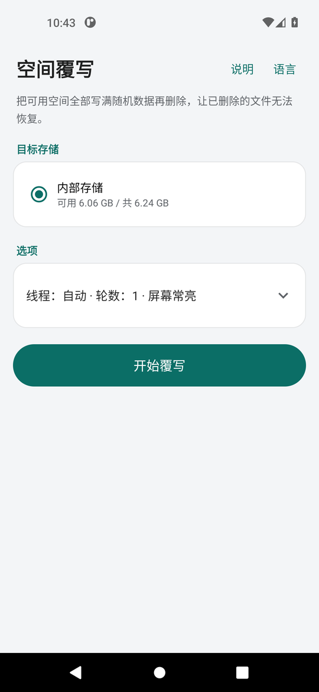
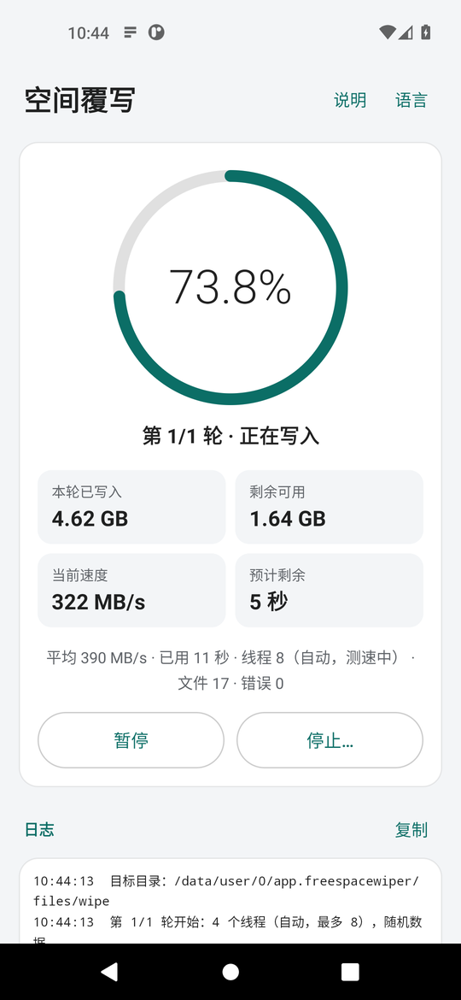
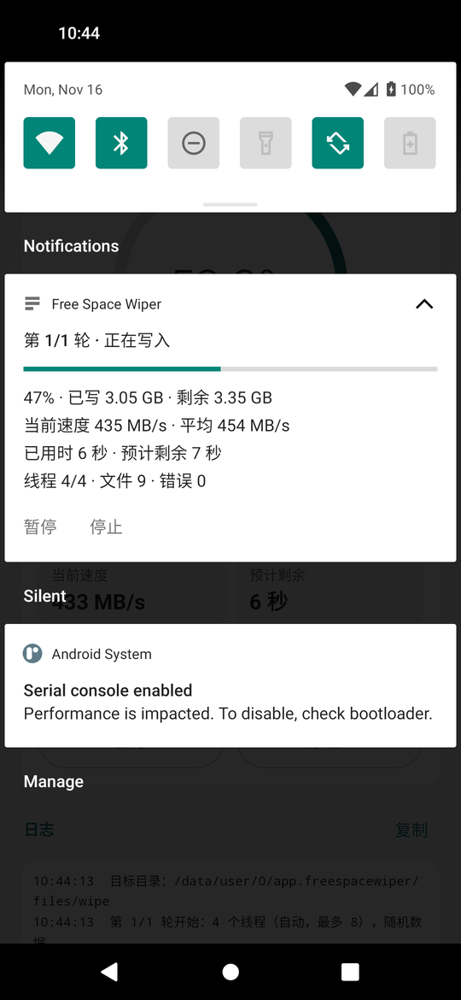
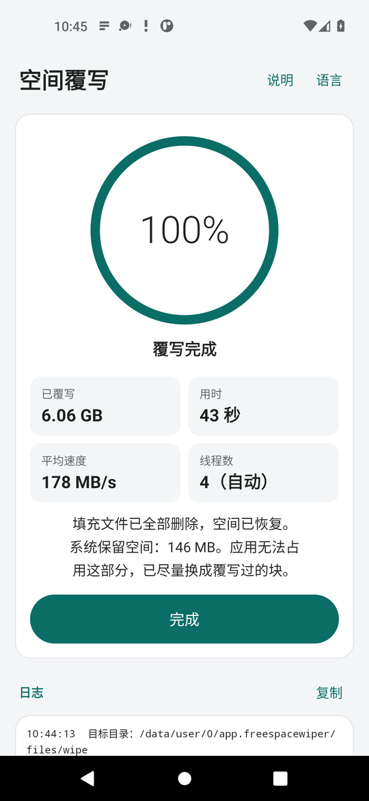
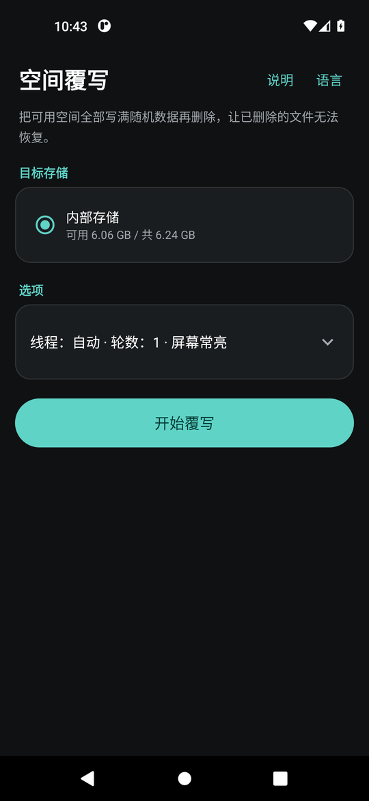

# 空间覆写 · Free Space Wiper

[English](README.md) | 简体中文

[](https://github.com/Tianket/FreeSpaceWiper/actions/workflows/build.yml)
[](https://github.com/Tianket/FreeSpaceWiper/actions/workflows/device-test.yml)
[](https://github.com/Tianket/FreeSpaceWiper/releases/latest)

一个 Android 应用：把存储的可用空间全部写满随机数据，确认数据落到闪存上，再把这些数据删除。已删除文件原先占用的空间因此被覆盖，数据恢复软件无法再找回旧内容。现有文件不会被改动。

界面支持简体中文和 English。应用没有联网权限，不包含任何第三方库。

<p>
  
  
  
  
  
</p>

## 功能

- **写满全部可用空间**：一直写到系统报告空间已满，再用小块数据挤满最后的缝隙。数据由 AES-256-CTR 生成，不可压缩。
- **清理系统保留区**：存储“写满”后，系统还保留着一小部分应用占用不了的空间，旧数据可能就留在里面。应用通过一个额外步骤让文件系统把这些块也交出来写一遍（原理见下文）。
- **自动选择并发数**：按 CPU 核数和内存确定起点和上限，运行时实测写入速度，只要速度还在提高就把线程数翻倍，最多 32 个。
- **不怕中断**：
  - 前台服务加唤醒锁，锁屏后继续写；首次启动时自动请求系统的“允许后台运行”。
  - 进程被系统结束后自动重启并接着写；手机重启后开机自动继续。已写入的数据不会丢。
  - 可以随时暂停和继续。电量降到 5% 且未充电时自动暂停，接上充电器后自动继续。
  - Android 11 及以上会显示系统上次结束进程的原因。
- **进度一目了然**：应用内显示进度环、已写入量、剩余空间、当前速度和预计剩余时间；通知栏同步显示进度，并可直接暂停或停止。
- **支持 SD 卡**：可移动存储会出现在目标列表里。
- 浅色和深色模式；Android 12 及以上跟随系统配色。

## 下载

需要 Android 6.0 或更高版本。

在[最新 Release](https://github.com/Tianket/FreeSpaceWiper/releases/latest) 下载 `FreeSpaceWiper-<版本号>.apk`。旁边的 `.sha256` 文件是校验值，Release 说明里也写着同一个值。

每次构建都用为这次构建临时生成的密钥签名，所以安装另一个 Release 的 APK 之前要先卸载旧的。

`main` 分支的最新构建也在 [Actions](https://github.com/Tianket/FreeSpaceWiper/actions/workflows/build.yml) 页面，名为 `FreeSpaceWiper-apk`（需要登录 GitHub）。该次运行的“APK checksum and contents”一步里有它的 SHA-256、权限列表、签名校验结果和类清单。

## 使用

1. 打开应用。首次启动时系统会询问是否允许应用在后台运行，选择允许。
2. 选好目标存储，点「开始覆写」。建议全程接着充电器。
3. 等待完成。期间存储会被临时写满，其他应用可能提示空间不足；完成后填充文件会自动删除。

默认设置适合绝大多数情况。「选项」平时折叠成一行，点开可以修改：

| 选项 | 说明 |
|---|---|
| 并发线程数 | 默认「自动」：从每个 CPU 核一个线程起步（最多 8 个），实测速度还在提高就翻倍。也可以固定为 2、4、8、16 或 32。闪存的写入能力是真正的上限，线程超过它之后不会更快。 |
| 覆写轮数 | 1 到 3 轮，默认 1 轮。闪存上 1 轮就够。 |
| 保持屏幕常亮 | 默认开启。亮屏并停留在应用界面，是防止部分厂商系统清理后台的最可靠办法。 |

部分厂商的系统还有各自的后台限制，需要手动放开一次：

| 品牌 | 设置位置 |
|---|---|
| 小米 / HyperOS | 应用信息 → 省电策略 → 无限制 |
| 华为 / 荣耀 | 应用启动管理 → 改为手动管理，允许后台活动 |
| OPPO / 一加 / realme | 电池 → 允许后台运行 |
| vivo / iQOO | 电池 → 允许后台高耗电 |
| 三星 | 电池 → 不受限制 |

## 工作原理

每一轮依次经过以下阶段：

| 阶段 | 做什么 |
|---|---|
| 写入 | 多个线程各自写文件（每个最大 1 GiB），每次写 1 MiB，直到系统返回“空间已满”。 |
| 填满 | 单线程用 64 KiB、再用 4 KiB 的小块把剩余空间挤满。 |
| 清理系统保留区 | 见下。 |
| 删除 | 删除所有填充文件，空间恢复可用。 |

几个关键点：

- **先落盘，再删除。** 每个文件关闭前都调用 `fsync`，写入过程中也定期调用。如果不这样做，还停留在内存缓存里的数据会随着文件被删除而直接丢弃，根本没有写到闪存上。
- **真实写入每一个字节。** 不使用 `fallocate` 或稀疏文件，文件系统必须交出它能交出的每一个块。
- **内存占用有上限。** 所有线程共享一个“已写入但尚未落盘”的数据预算（128 MiB 到 1 GiB，按内存大小确定），线程越多，每个线程落盘越频繁。增加线程不会增加内存压力。
- **线程数由实测决定。** 上限取 CPU 核数的 4 倍、内存档位（不足 3 GB 为 8，不足 6 GB 为 16，否则 32）和应用可用堆内存三者中最小的一个。自动模式每隔几秒比较一次写入速度：比上一个线程数快 8% 以上就翻倍再测，否则退回上一个数量并固定下来。

### 系统保留区是怎么清理的

文件系统通常为系统进程保留一部分空间。应用写到“空间已满”时，这部分块仍然空闲，里面可能还是旧数据。应用无法直接占用它们，但可以影响文件系统留下哪些块：

1. 存储写满后，删掉最早的几个填充文件，腾出大约两倍于保留区的空间。
2. 用 64 KiB 的小文件把这部分空间重新写满，然后隔一个删一个。这样腾出来的空间全是孤立的小洞。
3. 再用大文件写满。分配器偏好成片的空闲空间，于是先用掉保留区里剩下的大块，最后留下的是那些已经写过随机数据的小洞。

这个过程重复三轮。效果见下面的测试结果。

## 验证

三类测试都在 GitHub Actions 里运行，每次运行的日志里有当次的结果。

**单元测试**（18 个，`app/src/test`）：在模拟的小容量卷上运行真实引擎，覆盖写满、多轮、取消、暂停、续跑、单文件大小上限、写入错误、线程数自动调整、保留区清理和进度显示。

**原始磁盘检测**（`verify/run.sh`）：在真实文件系统的磁盘镜像上写入带标记的文件并删除，以普通用户身份运行引擎，然后扫描原始镜像，统计还能读到多少个带标记的块（每块 4 KiB）。镜像挂载时关闭了 discard，所以读到的就是文件系统没有重新写过的块。“老化”布局指卷已用 85%，带标记的文件与保留的文件交错存放，只删除带标记的那些。下表是开发期间 7 次运行的结果范围：

| 文件系统与场景 | 覆写前可读的标记块 | 覆写后 |
|---|---|---|
| F2FS，全新卷 | 550400 | 0 |
| F2FS，老化卷 | 314880 | 0 |
| F2FS，老化卷，带系统保留空间（`reserve_root`，与 Android 相同） | 314880 | 0 |
| F2FS，覆写中途被 `kill -9` 后续跑 | 550400 | 0 到 129 |
| ext4，全新卷（5% 系统保留） | 550400 | 0 到 19 |
| ext4，老化卷（5% 系统保留） | 317440 | 0 到 27 |
| ext4，覆写中途被 `kill -9` 后续跑 | 550400 | 0 到 3 |
| ext4，老化卷，关闭保留区清理（对照） | 317440 | 29842 到 32153 |

残留最多的一次是 129 块，占 0.02%。测试的通过标准是残留不超过 0.1%。

本地运行：`verify/run.sh ext4` 或 `LAYOUT=aged verify/run.sh f2fs`，需要 sudo、JDK 和 python3，选项见脚本开头的说明。

**模拟器实测**（`ci/device_test.py`）：在 Android 6、11、14 的模拟器上安装构建出的 APK，通过 adb 像用户一样点击操作，再以 root 身份读取设备上的真实状态来判定结果（填充文件的大小、前台服务、唤醒锁、通知、电池优化白名单）。覆盖的场景：

- 首次启动弹出系统的后台运行许可；允许后应用进入电池优化白名单。
- 中英文切换和深色模式。
- 完整覆写一次：通知带进度，服务在前台运行并持有唤醒锁；结束后填充文件清空，可用空间恢复。
- 暂停、继续和停止。
- 用 `kill -9` 结束进程：系统自动重启服务并接着写，之前写入的数据保留。
- 电量降到 3% 且未充电时自动暂停，接上充电器后自动继续。
- 重启设备：开机后自动继续并完成。

每次运行的截图和日志保存在该次运行的 `device-test-apiNN` 附件里。

## 权限

| 权限 | 用途 |
|---|---|
| `FOREGROUND_SERVICE`、`FOREGROUND_SERVICE_SPECIAL_USE` | 以前台服务运行覆写任务 |
| `WAKE_LOCK` | 锁屏后保持 CPU 运行 |
| `POST_NOTIFICATIONS` | 在通知栏显示进度和结果 |
| `REQUEST_IGNORE_BATTERY_OPTIMIZATIONS` | 请求系统允许应用在后台运行 |
| `RECEIVE_BOOT_COMPLETED` | 手机重启后继续被打断的任务 |

应用不申请联网权限和存储权限，只在自己的目录里写文件。应用私有目录与内部存储位于同一个分区，写满它就等于写满整个内部存储；SD 卡使用卡上的应用专属目录。

## 局限

- 文件名、时间戳和极小文件的内容可能保存在文件系统的元数据区，填充可用空间覆盖不到这些位置。
- 文件系统内部留用的少量空间不一定都能换出来，上面的测试结果就是这部分的实测值。
- 闪存控制器内部的备用块（用于磨损均衡和预留空间）对任何应用都不可见。
- 存储加密加上恢复出厂设置可以覆盖以上几处：恢复出厂会销毁加密密钥。需要清空整台设备时，应先恢复出厂设置，再运行本应用。
- 应用只覆写可用空间，不提供“粉碎单个文件”：在闪存和 F2FS 上，覆写一个文件时新数据会写到别的位置，旧数据块并不会被覆盖。
- 模拟器测试覆盖的是原生 Android。各厂商系统的后台管理策略各不相同，没有逐一实测。

## 构建

需要 JDK 17 和 Android SDK（API 34）。

```
./gradlew assembleRelease
```

生成 `app/build/outputs/apk/release/app-release.apk`。也可以用 Android Studio 直接打开本目录。

```
./gradlew test          # 单元测试
./gradlew lintRelease   # Lint
```

发布新版本：先在 `app/build.gradle` 里提高 `versionCode` 和 `versionName`，再在 **Actions → Release → Run workflow** 运行。它会构建 APK，连同校验值一起发布为 `v<versionName>`。推送 `v<versionName>` 格式的标签也可以触发。

## 项目结构

```
app/src/main/java/app/freespacewiper/
  engine/                 纯 Java 核心，不依赖 Android，可在桌面 JVM 上运行和测试
    WipeEngine.java         写入、填满、清理保留区、删除；暂停、取消、续跑、线程数调整
    WipeConfig.java         任务参数
    Snapshot.java           进度快照
    DataSource.java         AES-256-CTR 随机数据流
    Platform.java           文件系统抽象（open / write / fsync / statvfs）
  AndroidPlatform.java    通过 android.system.Os 直接进行系统调用
  WipeService.java        前台服务：唤醒锁、通知、暂停与继续、低电量处理、被结束后恢复
  MainActivity.java       界面：开始前、运行中、结果三种状态
  RingProgressView.java   进度环
  DeviceInfo.java         根据 CPU 和内存确定线程数的起点、上限和内存预算
  JobStore.java           任务状态持久化（存储写满时仍然可靠）
  BootReceiver.java       开机后继续被打断的任务
  Recovery.java           无法继续时的善后：清理或保留填充文件
  ExitReasons.java        读取系统记录的进程结束原因（Android 11+）
app/src/main/res/         界面资源；values 为英文，values-zh 为简体中文
app/src/test/             引擎的单元测试
verify/                   原始磁盘检测脚本
ci/                       模拟器启动脚本与实测脚本
.github/workflows/        构建与原始磁盘检测（build.yml）、模拟器实测（device-test.yml）、发布（release.yml）
```
